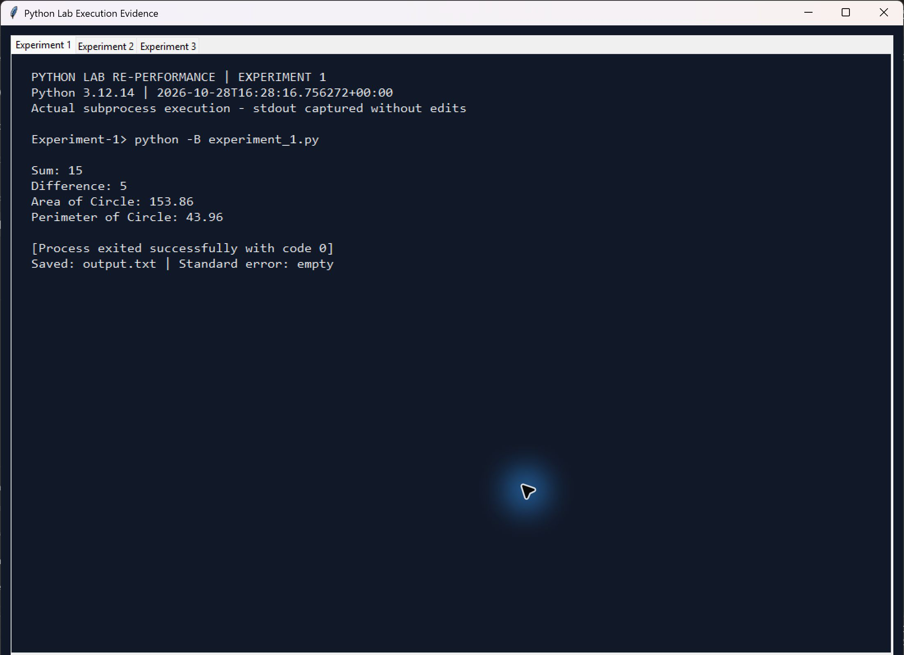

# Experiment 1: Creating and Using Python Packages and Modules

**Original practical:** 8 (visible page heading)  
**Reference file:** Practical No 8 (1).pdf

## Aim

To create a Python package and import its modules to demonstrate reusable, organised code.

## Problem statement and required program

Create MyPackage with arithmetic and geometry modules. Import both in a main program, add and subtract 10 and 5, and calculate the area and perimeter of a circle with radius 7.

## Brief theory

A module is a Python file containing reusable definitions. A package groups related modules in a directory. This experiment uses an empty __init__.py to create a regular package and imports its arithmetic and geometry modules. The geometry formulas retain pi = 3.14 as specified in the assignment.

## Algorithm

1. Create MyPackage with an empty __init__.py.
2. Define add() and subtract() in arithmetic.py.
3. Define area_of_circle() and perimeter_of_circle() in geometry.py.
4. Import both modules in experiment_1.py.
5. Call the functions with 10, 5 and radius 7.
6. Display the arithmetic results and format the circle results to two decimal places.

## Python code explanation

experiment_1.py is the main.py equivalent from the assignment, renamed to match the submission structure. The arithmetic module returns the sum or difference of its arguments. The geometry module applies 3.14 * radius * radius and 2 * 3.14 * radius. The main() function prints the four results. The __name__ guard prevents the demonstration from running during import.

Read the executable code in [experiment_1.py](experiment_1.py).

## Run

From the repository root, with Python 3.10 or newer:

```console
python Experiment-1/experiment_1.py
```

No third-party dependencies or keyboard input are needed. The inputs are fixed in the main program to reproduce the original assignment.

## Expected output

Sum 15; difference 5; circle area 153.86; circle perimeter 43.96.

## Actual execution output

Captured from a successful Python 3.12.14 subprocess at 2026-10-28T16:28:16.756272+00:00 (UTC). Exit code: 0; standard error: empty. [output.txt](output.txt) contains stdout only.

```text
Sum: 15
Difference: 5
Area of Circle: 153.86
Perimeter of Circle: 43.96
```



The image is a screenshot of the execution viewer displaying the actual subprocess stdout, command, Python version and exit status. It is not a screenshot of a native terminal window. [Execution metadata](outputs/execution.json) records the same run.

## Corrections and implementation notes

The original functionality and sample inputs are retained. Formatting the circle values to two decimal places avoids displaying binary floating-point noise. MyPackage and its three files are included because a single standalone file would not demonstrate creating a package.

## Verification

The repository's [verification script](../verify_experiments.py) executes this program, compares stdout with output.txt and checks the experiment's behaviour. See the captured [verification results](../verification.txt).

## Result / conclusion

The program successfully imports and uses modules from MyPackage. The four captured values match the assignment's expected results.

## Review questions

1. **What is a module?** A Python file containing reusable functions, classes or variables.
2. **What is __init__.py for?** It identifies a regular package and can contain package initialisation code. It is empty here. Python also supports namespace packages without this file.
3. **How do you import one function?** `from MyPackage.arithmetic import add`.
4. **Why use packages?** They organise related code, support reuse and make maintenance easier.
5. **Example with three modules:**

```text
MyPackage/
    __init__.py
    maths.py
    string_ops.py
    file_ops.py
```
