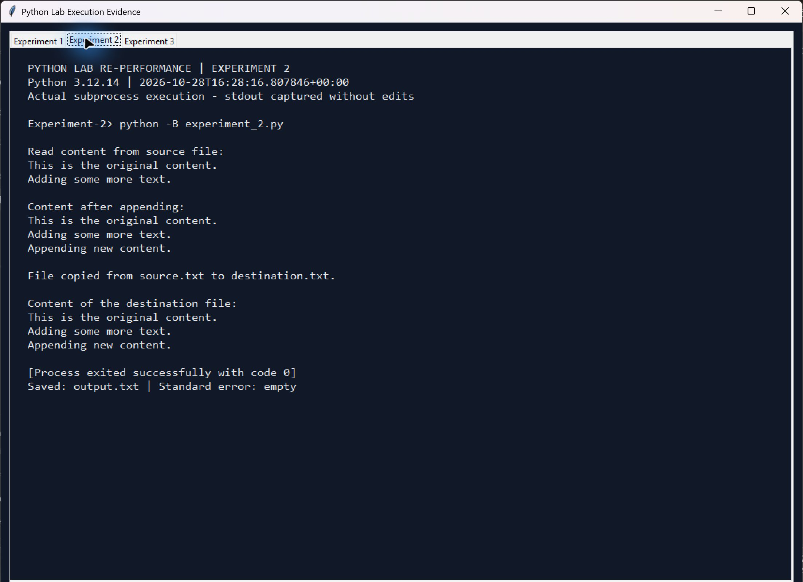

# Experiment 2: File Handling: Open, Close, Read, Write, Append and Copy

**Original practical:** 9 (visible page heading)  
**Reference file:** Practical No 9 (2).pdf

## Aim

To perform Python file operations: opening, closing, reading, writing, appending and copying content from one file to another.

## Problem statement and required program

Write the assignment's original content to source.txt, read and display it, append new content, display the updated file, copy it to destination.txt and read back the destination.

## Brief theory

open() selects a file mode: w creates or replaces content, r reads existing content, and a appends at the end. A with block automatically closes its file, including when an exception occurs. shutil.copy() copies the source file to the destination. OSError handles file-system failures; IOError is an alias for OSError in Python 3.

## Algorithm

1. Resolve the experiment's outputs directory and create it if needed.
2. Open source.txt in write mode and write the original two lines.
3. Close it, reopen in read mode and display the content.
4. Open in append mode and add the third line.
5. Reopen in read mode and display the updated content.
6. Copy source.txt to destination.txt using shutil.copy().
7. Read and display destination.txt.
8. Report an I/O error and return a nonzero exit code if any operation fails.

## Python code explanation

Path(__file__) keeps generated files inside this experiment even when the script is started from another directory. Each with open(...) block closes the file automatically. The program uses the original three text lines and source/destination filenames. It reports success only after reading back the destination. main() returns 0 for success or 1 for an I/O failure.

Read the executable code in [experiment_2.py](experiment_2.py).

## Run

From the repository root, with Python 3.10 or newer:

```console
python Experiment-2/experiment_2.py
```

No third-party dependencies or keyboard input are needed. The inputs are fixed in the main program to reproduce the original assignment.

## Expected output

The first read contains the original two lines. After appending, the source and destination both contain all three lines. The captured console output below shows every stage.

## Actual execution output

Captured from a successful Python 3.12.14 subprocess at 2026-10-28T16:28:16.807846+00:00 (UTC). Exit code: 0; standard error: empty. [output.txt](output.txt) contains stdout only.

```text
Read content from source file:
This is the original content.
Adding some more text.

Content after appending:
This is the original content.
Adding some more text.
Appending new content.

File copied from source.txt to destination.txt.

Content of the destination file:
This is the original content.
Adding some more text.
Appending new content.
```



The image is a screenshot of the execution viewer displaying the actual subprocess stdout, command, Python version and exit status. It is not a screenshot of a native terminal window. [Execution metadata](outputs/execution.json) records the same run.

## Corrections and implementation notes

The PDF attempts file.read() on a write-only or already-closed file. The program closes the write handle and reopens the file in r mode before reading. Broken indentation and wrapped statements are repaired. The unused append_file variable is omitted: the supplied algorithm appends to source.txt. Generated files are stored in outputs/ to keep file operations contained. Each run starts with w mode, so repeated execution does not accumulate appended lines.

## Verification

The repository's [verification script](../verify_experiments.py) executes this program, compares stdout with output.txt and checks the experiment's behaviour. See the captured [verification results](../verification.txt).

## Result / conclusion

Writing, reading, appending and copying completed successfully. Verification checked that source.txt and destination.txt contain the expected three lines and are identical byte for byte.

## Review questions

The PDF also asks about CSV files. These are related review questions; the required experiment operates on plain text files. All snippets use Python's standard csv module.

```python
import csv

# 1. Read CSV rows into a list.
with open('data.csv', newline='', encoding='utf-8') as file:
    rows = list(csv.reader(file))

# 2. Write a list of lists.
with open('data.csv', 'w', newline='', encoding='utf-8') as file:
    csv.writer(file).writerows([['name', 'marks'], ['Student', 90]])

# 3. Read rows as dictionaries using the header as keys.
with open('data.csv', newline='', encoding='utf-8') as file:
    records = list(csv.DictReader(file))

# 4. Append one row.
with open('data.csv', 'a', newline='', encoding='utf-8') as file:
    csv.writer(file).writerow(['Another student', 85])

# 5. Skip the header safely.
with open('data.csv', newline='', encoding='utf-8') as file:
    reader = csv.reader(file)
    next(reader, None)
    rows_without_header = list(reader)
```

These snippets answer the review questions; their output is not presented as execution evidence for this text-file experiment.
