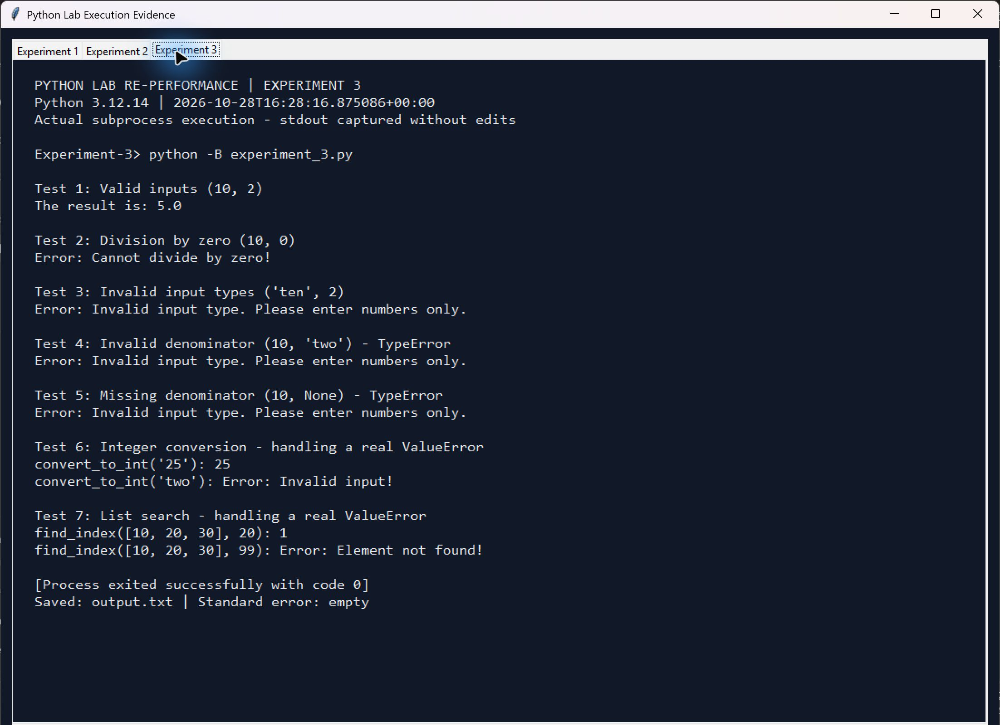

# Experiment 3: Handling Python Built-in Exceptions

**Original practical:** 10 (visible page heading)  
**Reference file:** Practical No 10 (1).pdf

## Aim

To handle Python built-in exceptions and produce useful error messages while allowing subsequent operations to continue.

## Problem statement and required program

Implement divide_numbers() using try/except and run the original five calls: (10, 2), (10, 0), ('ten', 2), (10, 'two') and (10, None). Also implement the integer-conversion and list-search functions requested in the review questions to demonstrate real ValueError cases.

## Brief theory

A try block contains an operation that can fail. Specific except clauses handle known errors before a final Exception fallback. Division by zero raises ZeroDivisionError. Dividing incompatible built-in types raises TypeError. int('two') and list.index() for an absent element raise ValueError. Handling one error lets later demonstrations run.

## Algorithm

1. Define divide_numbers(num1, num2).
2. Divide inside try and print the result if successful.
3. Catch ZeroDivisionError, TypeError and ValueError separately.
4. Add an Exception fallback for other ordinary exceptions.
5. Execute all five division calls from the assignment.
6. Define convert_to_int() and find_index() with ValueError handlers.
7. Demonstrate successful and invalid conversion/search inputs.
8. Continue through every case without an unhandled exception.

## Python code explanation

divide_numbers() preserves the original division operation and specific handlers. It returns the quotient after successful division. The error branches print clear messages. convert_to_int() returns an integer or 'Error: Invalid input!'; find_index() returns a zero-based index or 'Error: Element not found!'. main() labels and runs each case.

Read the executable code in [experiment_3.py](experiment_3.py).

## Run

From the repository root, with Python 3.10 or newer:

```console
python Experiment-3/experiment_3.py
```

No third-party dependencies or keyboard input are needed. The inputs are fixed in the main program to reproduce the original assignment.

## Expected output

The valid division returns 5.0. The zero denominator is handled. The three incompatible-type calls are all handled as TypeError. The added conversion and list-search calls demonstrate both success and real ValueError handling.

## Actual execution output

Captured from a successful Python 3.12.14 subprocess at 2026-10-28T16:28:16.875086+00:00 (UTC). Exit code: 0; standard error: empty. [output.txt](output.txt) contains stdout only.

```text
Test 1: Valid inputs (10, 2)
The result is: 5.0

Test 2: Division by zero (10, 0)
Error: Cannot divide by zero!

Test 3: Invalid input types ('ten', 2)
Error: Invalid input type. Please enter numbers only.

Test 4: Invalid denominator (10, 'two') - TypeError
Error: Invalid input type. Please enter numbers only.

Test 5: Missing denominator (10, None) - TypeError
Error: Invalid input type. Please enter numbers only.

Test 6: Integer conversion - handling a real ValueError
convert_to_int('25'): 25
convert_to_int('two'): Error: Invalid input!

Test 7: List search - handling a real ValueError
find_index([10, 20, 30], 20): 1
find_index([10, 20, 30], 99): Error: Element not found!
```



The image is a screenshot of the execution viewer displaying the actual subprocess stdout, command, Python version and exit status. It is not a screenshot of a native terminal window. [Execution metadata](outputs/execution.json) records the same run.

## Corrections and implementation notes

The PDF labels 10 / 'two' as ValueError and 10 / None as an unexpected error, but Python raises TypeError for both and the earlier TypeError handler catches them. The code preserves those original inputs and reports the actual behaviour. A genuine ValueError is demonstrated with the conversion/search functions asked for in the same PDF. The broad fallback remains in divide_numbers(); the verification script checks it with a controlled RuntimeError from a small test double. That injected test is only a handler check, not a claim that 10 / None reaches the fallback. The division ValueError branch is similarly checked with a controlled test double, since these built-in division inputs do not reach it.

## Verification

The repository's [verification script](../verify_experiments.py) executes this program, compares stdout with output.txt and checks the experiment's behaviour. See the captured [verification results](../verification.txt).

## Result / conclusion

All original division cases and the added question-function examples complete successfully. Invalid inputs produce handled error messages, and later tests continue running.

## Review questions

1. **Out-of-range list index:** IndexError.
2. **Invalid integer conversion:** ValueError, for example int('two').
3. **convert_to_int(s):** Implemented in experiment_3.py; returns int(s) or 'Error: Invalid input!'.
4. **Custom exception:** Subclass Exception, for example:

```python
class InvalidMarkError(Exception):
    pass
```

5. **find_index(lst, elem):** Implemented in experiment_3.py; returns lst.index(elem) or 'Error: Element not found!'.
